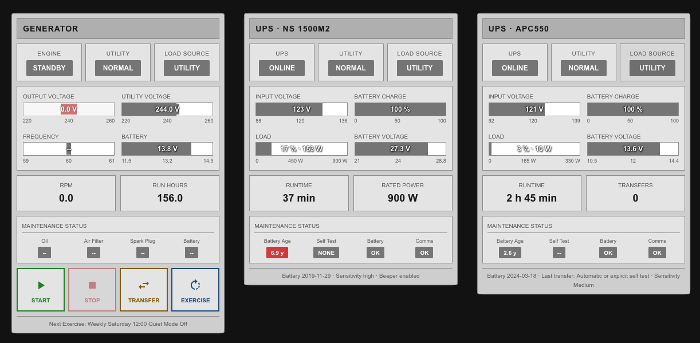

# UPS HMI Card

An ISA-101 Human Machine Interface (HMI) card for Home Assistant UPSs. It works with the **NUT** and **APC UPS Daemon** integrations.

It's a companion to [generator-hmi-card](https://github.com/jtubb/generator-hmi-card) by [jtubb](https://github.com/jtubb). The industrial gray styling, layout and status colours come from that card, adapted to show UPS data. Used together, the UPS card's **Load Source** shows **GENERATOR** when your Genmon generator is carrying the load.



## Features

- **ISA-101 high-performance design:** gray when normal, blue when abnormal, amber for warnings, red for alarms. Same look as the Generator HMI Card.
- **Status indicators:** UPS state, utility power and load source (Utility / Battery / Generator).
- **Bar gauges:**
  - **Input voltage:** the scale runs between the UPS's own low and high transfer voltages, so you can see how close the mains is to sending the UPS onto battery.
  - **Battery charge:** warning and alarm bands taken from the UPS's own low-battery setpoints.
  - **Load:** shown in watts as well as percent when the UPS's rated power is known.
  - **Battery voltage:** scaled to the pack's nominal voltage (12 V or 24 V).
- **Runtime remaining**, plus time on battery during an outage.
- **Maintenance status:** battery age, self-test result, replace-battery flag and communications.
- **Generator link:** optional. Reads Genmon's binary sensors to show when the generator is carrying the load.
- **Tap to inspect:** tapping any value opens Home Assistant's details dialog for its sensor.

## Installation

### HACS (custom repository)
1. Open HACS in Home Assistant.
2. Click the menu (three dots) and choose **Custom repositories**.
3. Add `https://github.com/mdisabato/ups-hmi-card` with the type **Dashboard**.
4. Install **UPS HMI Card**.
5. Reload your browser.

### Manual
1. Copy `ups-hmi-card.js` to `/config/www/ups-hmi-card/`.
2. Add a resource: **Settings → Dashboards → ⋮ → Resources → Add resource**
   - URL: `/local/ups-hmi-card/ups-hmi-card.js?v=1.0.0`
   - Type: JavaScript module

When you update the file, bump the `?v=` number so browsers load the new copy instead of a cached one.

## Before you start: enable the UPS sensors

Both integrations ship with many of their sensors disabled. Go to **Settings → Devices & services → [your UPS] → entities** and enable the hidden ones, especially:

| | NUT | APC UPS Daemon |
|---|---|---|
| Transfer voltages | Low / High voltage transfer | Transfer low / Transfer high |
| Battery voltage | Battery voltage, Nominal battery voltage | Battery voltage, Battery nominal voltage |
| Battery date | Battery date, Battery manuf date | Battery replaced |
| Self test | Self test result | Last self-test |
| Other | Nominal real power, Low/Warning battery setpoint, Low battery runtime, Beeper status | Time on battery, Transfer count, Last transfer, Sensitivity |

The card works without these, but shows `--` wherever a sensor is missing.

## Configuration

### NUT

```yaml
type: custom:ups-hmi-card
title: UPS · NS 1500M2
integration: nut
device_name: ups_apc_ns_1500m2
generator: genny
```

### APC UPS Daemon

```yaml
type: custom:ups-hmi-card
title: UPS · APC550
integration: apcupsd
device_name: ups_apc550
generator: genny
nominal_power: 330
```

`device_name` is the part of your entity IDs between `sensor.` and the sensor name. For example, if your entities look like `sensor.ups_apc550_battery`, use `ups_apc550`.

### Options

| Option | Type | Default | Description |
|--------|------|---------|-------------|
| `integration` | string | `nut` | `nut` or `apcupsd`; picks the default sensor names |
| `device_name` | string | — | Entity name prefix (required unless `entity_prefix` is set) |
| `entity_prefix` | string | auto | Overrides the sensor prefix, e.g. `sensor.my_ups_` |
| `title` | string | `UPS` | Header title |
| `generator` | string | — | Genmon device name (e.g. `genny`); turns on the GENERATOR load source |
| `generator_entities` | map | — | Overrides the Genmon entities (`running`, `transfer`, `outage`) |
| `nominal_power` | number | from sensor | Rated output in watts, used to show load in W |
| `battery_age_warning` | number | `3` | Battery age in years that turns the badge amber |
| `battery_age_alarm` | number | `5` | Battery age in years that turns the badge red |
| `load_warning` | number | `80` | Load % that turns the load bar amber |
| `load_alarm` | number | `95` | Load % that turns the load bar red |
| `show_maintenance` | boolean | `true` | Show the maintenance status row |
| `entities` | map | — | Points individual values at specific sensors (see below) |

### Entity overrides

Different UPS models and integration versions name sensors differently. If a value shows `--`, point it at the right sensor with `entities`. Each value must be a full entity ID:

```yaml
type: custom:ups-hmi-card
integration: nut
device_name: my_ups
entities:
  battery_voltage: sensor.some_other_battery_voltage
  nominal_power: sensor.my_ups_nominal_power
```

| Key | NUT default | APC UPS Daemon default |
|-----|-------------|------------------------|
| `status` | `status_data` | `status` |
| `input_voltage` | `input_voltage` | `input_voltage` |
| `transfer_low` | `low_voltage_transfer` | `transfer_low` |
| `transfer_high` | `high_voltage_transfer` | `transfer_high` |
| `nominal_input_voltage` | `nominal_input_voltage` | `nominal_input_voltage` |
| `battery_charge` | `battery_charge` | `battery` |
| `battery_charge_low` | `low_battery_setpoint` | `battery_shutdown` |
| `battery_charge_warning` | `warning_battery_setpoint` | — |
| `battery_voltage` | `battery_voltage` | `battery_voltage` |
| `battery_nominal_voltage` | `nominal_battery_voltage` | `battery_nominal_voltage` |
| `load` | `load` | `load` |
| `nominal_power` | `nominal_real_power` | `nominal_output_power` |
| `runtime` | `battery_runtime` | `time_left` |
| `runtime_low` | `low_battery_runtime` | — |
| `time_on_battery` | — | `time_on_battery` |
| `transfer_count` | — | `transfer_count` |
| `battery_date` | `battery_date` | `battery_replaced` |
| `battery_mfr_date` | `battery_manuf_date` | — |
| `self_test` | `self_test_result` | `last_self_test` |
| `beeper` | `beeper_status` | — |
| `sensitivity` | `input_power_sensitivity` | `sensitivity` |
| `last_transfer` | — | `last_transfer` |

## How the status blocks work

The card reads the UPS status codes from either integration:
- **NUT:** `OL`, `OB`, `LB`, `RB`, `CHRG`, `OVER`, `TRIM`, `BOOST`, `CAL`, `FSD`, `OFF`
- **APC UPS Daemon:** `ONLINE`, `ONBATT`, `LOWBATT`, `REPLACEBATT`, `OVERLOAD`, `COMMLOST`, `SELFTEST`, `SHUTTING DOWN`

**UPS**

| Shown | When | Colour |
|---|---|---|
| ONLINE | On mains, nothing else to report | Gray |
| CHARGING / AVR TRIM / AVR BOOST / SELF TEST | Normal but active | Blue |
| ON BATTERY / REPLACE BATT / OFF | Needs attention | Amber |
| LOW BATTERY / OVERLOAD / SHUTDOWN / COMMS LOST | Act now | Red |

**Utility** shows **OUTAGE** (red) when the UPS is on battery for any reason other than a self-test, or when Genmon reports an outage. Otherwise it shows **NORMAL**.

**Load source**

| Shown | When | Colour |
|---|---|---|
| UTILITY | Normal | Gray |
| GENERATOR | Genmon's transfer switch is on generator, or the generator is running during an outage | Blue |
| BATTERY | The UPS is on battery. This takes priority over GENERATOR, e.g. in the seconds before the generator takes the load | Amber |

With `generator: genny`, the card reads `binary_sensor.genny_generator_running`, `binary_sensor.genny_transfer_to_generator` and `binary_sensor.genny_system_in_outage`. A generator exercise with no outage does **not** show as GENERATOR.

## Maintenance status

| Badge | Source | Logic |
|---|---|---|
| Battery Age | Battery install / replaced date and manufacture date | Uses the newer of the two dates. Gray under `battery_age_warning`, amber up to `battery_age_alarm`, red beyond it |
| Self Test | Self-test result | PASS (gray), NONE (gray), TESTING (blue), FAIL (red) |
| Battery | Replace-battery flag (`RB` / `REPLACEBATT`) | OK or REPLACE (red) |
| Comms | Status sensor availability | OK, or LOST (red) when the integration can't reach the UPS |

Many APC units report a factory placeholder (e.g. `2001/09/25`) as NUT's battery date until someone sets it. Using the newer of the two dates keeps that placeholder from making a newer battery look ancient.

## License

MIT License. See [LICENSE](LICENSE).

## Credits

- Styling, layout and ISA-101 colours from [generator-hmi-card](https://github.com/jtubb/generator-hmi-card) by [jtubb](https://github.com/jtubb), MIT License
- Designed to sit alongside [Genmon](https://github.com/jgyates/genmon)
- Works with Home Assistant's [NUT](https://www.home-assistant.io/integrations/nut/) and [APC UPS Daemon](https://www.home-assistant.io/integrations/apcupsd/) integrations
